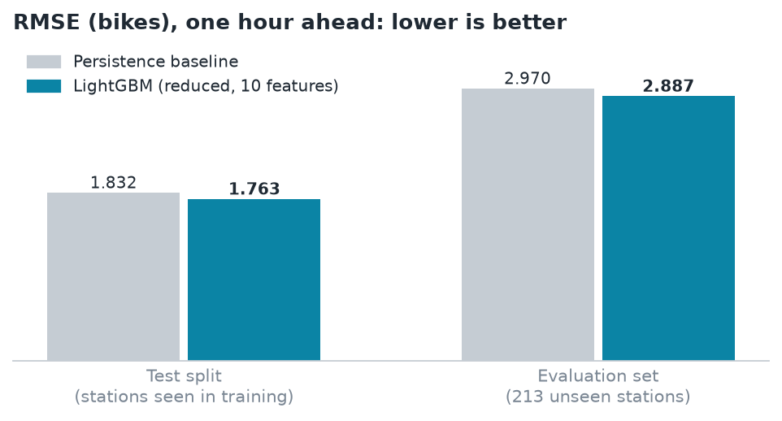
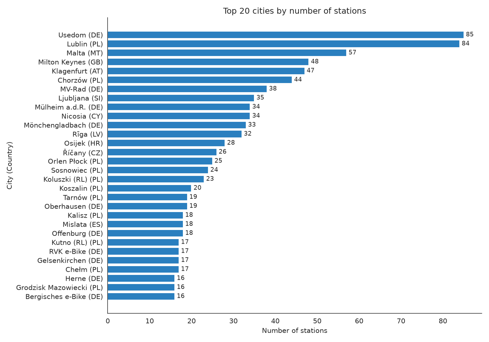
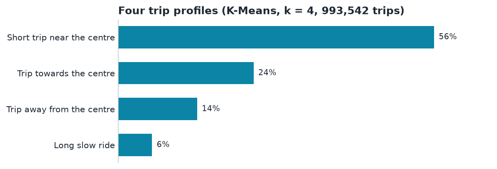
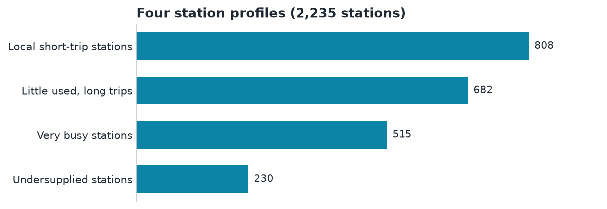

# Bike-Sharing Challenge

**Analysis and prediction over European bike-sharing data.** *Fundamentals of Machine Learning (FML) 2026 Challenge, IMT Atlantique.*

We explore one year of bike-sharing data (August 2022 to July 2023), discover how trips and stations naturally group together, and build a model that predicts **how many bikes will be available at a station one hour later**, so operators can plan rebalancing in advance.

| | |
|---|---|
| **Data** | 267 schemes in 15 countries, 2,932 stations, 1.16 M trips, 2.9 M station-status records |
| **Unsupervised** | 4 trip profiles (K-Means) and 4 station profiles (PCA + K-Means) |
| **Supervised** | LightGBM on the 1-hour change in availability, beats persistence on unseen stations |
| **Full write-up** | [`docs/report.pdf`](docs/report.pdf) |

---

## Table of contents

1. [Key results](#key-results)
2. [Data exploration and preprocessing](#1-data-exploration-and-preprocessing)
3. [Trip profiles](#2-trip-profiles-unsupervised-part-a)
4. [Station profiles](#3-station-profiles-unsupervised-part-b)
5. [Predicting station availability](#4-predicting-station-availability-supervised)
6. [Repository structure](#repository-structure)
7. [Getting started](#getting-started)
8. [Team](#team)

---

## Key results

- **Cleaning matters.** Missing batteries are not errors: 84.5% of bikes are human-powered, so a missing value means "no battery". Missing station identifiers were *not* explained by cities that allow free-floating returns (we tested the hypothesis and rejected it).
- **Trips form a continuum, not neat groups.** Four profiles emerge (56% are short trips near the centre), but the silhouette stays below 0.27. The profile mix depends on the city far more than on the rider.
- **Stations split into four roles:** very busy, local short-trip, little used with long trips, and undersupplied. Undersupplied stations are concentrated in e-bike systems.
- **Persistence is a tough baseline.** In 53% of cases nothing changes within an hour, so we predict the *change* Δ: a model that outputs zero is exactly persistence.
- **The model generalises.** On 213 stations never seen in training it still beats persistence (RMSE 2.887 vs 2.970), mainly by reducing large errors.



---

## 1. Data exploration and preprocessing

Six raw tables were audited, cleaned and documented. The main decisions:

| Table | Highlights |
|---|---|
| **Bike types** | 121 types, but 5 types make up 72% of the fleet. E-bikes are 30% of the types yet only 7% of the bikes. The 30 empty types were kept (1,050 bikes use them) and 9 were reclassified as *human* using battery evidence. |
| **Trips** | 1,161,376 rows reduced to **993,542** clean rows. Missing batteries set to 0 for human bikes; 137 unexplained rows and rows without a station dropped (quasi-MCAR). |
| **Stations** | 2,932 stations in 185 cities. Empty columns removed, 32 impossible `special_racks` values set aside, one wrong coordinate repaired. More than a quarter have no racks, which suggests virtual stations. |
| **Cities** | 267 schemes in 15 countries, text normalised, no duplicates. |
| **Station status** | 2.9 M records. 160 impossible negative `booked_bikes` removed. Sampling is very irregular (median gap 28 min, 16% of gaps above 6 h) and there is a feed outage in May 2023. Timestamps converted to local time per city. Germany and Poland make up about 87% of the data. |

Stations are unevenly spread over a few very dense systems:



> Interactive heat map of station density: [`assets/carte_robuste.html`](assets/carte_robuste.html) (download it and open it in a browser).

---

## 2. Trip profiles (unsupervised, part A)

We clustered 993,542 trips described by seven features: duration, straight-line distance, speed, hour of day, distance of the start to the city centre and direction relative to the centre. K-Means with **k = 4** was kept because it is far more stable than Ward (ARI 0.991 vs 0.626), even though Ward separates slightly better (silhouette 0.265 vs 0.230).



| Profile | Share | Typical trip |
|---|---:|---|
| Short trip near the centre | 56% | 9 min, 1.0 km, starts and stays near the centre |
| Trip towards the centre | 24% | 13 min, 2.1 km, ends 1.1 km closer to the centre |
| Trip away from the centre | 14% | 19 min, 3.1 km, 10.5 km/h, e-bikes over-represented (29% vs 16%) |
| Long slow ride | 6% | 92 min, ends 1.8 km from the start, more frequent at weekends |

**Insights**

- Weekdays peak at 7-8h and even more at 16-17h (probably work and school); weekends have no morning peak.
- The share of each profile depends strongly on the system: short central trips range from 5% in Swansea University to 75% in Sursee Plus. The profiles describe the *systems* at least as much as the *riders*.
- Limits: groups overlap, there is no rider identifier, and distances are straight lines, so a loop looks short and slow.

> Interactive map of trip start points by profile: [`assets/trip_profiles_map.html`](assets/trip_profiles_map.html).

---

## 3. Station profiles (unsupervised, part B)

Six features per station were built from trips and status records: daily departures, daily arrivals, average trip duration, average endpoint distance, average available bikes and the share of empty records. After a `log1p` transform and PCA (the first 3 components keep 93% of the variance), K-Means with **k = 4** was confirmed with Ward and GMM. 2,235 of 2,900 stations had enough data to be clustered.



| Profile | Stations | What defines it |
|---|---:|---|
| Local short-trip stations | 808 | Short trips (about 16 min) at the local level |
| Little used, long trips | 682 | Low activity but long trips (about 33 min) |
| Very busy stations | 515 | About 3.5 departures per day |
| Undersupplied stations | 230 | Empty about 24% of the time |

**Insights**

- Clusters depend heavily on the country or system. In Rīga, 82% of the stations are little used for long trips.
- Undersupplied stations concentrate in **electric-bike systems** (RVK e-Bike: 25 of 36 stations, Bergisches e-Bike: 20 of 30).
- Limits: weak separation (silhouette up to 0.30, ARI between methods 0.21 to 0.44), whole-period averages, no weekday/weekend split, station capacity not used.

The cluster labels are exported to [`output/part_b/station_clusters.csv`](output/part_b/station_clusters.csv).

---

## 4. Predicting station availability (supervised)

**Goal:** predict `bikes_available_to_rent` at a station **one hour ahead**.

**Formulation**

- `station_status` is an event log, not a regular time series. The target at *t + 1h* is the last observation before that time (last observation carried forward, LOCF). The big May 2023 outage and the last hour of each station are removed.
- We train on the change **Δ = y(t+1h) − y(t)** and predict `y(t) + Δ̂`, clipped to `[0, capacity]` and rounded.
- **Features:** current state (bikes, free racks, capacity, fill ratio, maintenance), lags at 1, 3 and 24 hours, time since the last event, cyclic hour encoding, day of week, number of racks and temperature from Open-Meteo (always taken at *t*, never at *t + 1h*, to avoid leakage).
- **Validation:** temporal split. Train before 1 June 2023 (about 75%), test after 3 June, with a 48-hour gap because of the 24-hour lag. A random split would put almost identical rows in both sets.

**Models and results** (errors in bikes)

| Model | Test MAE | Test RMSE | Eval MAE | Eval RMSE |
|---|---:|---:|---:|---:|
| Persistence baseline | 1.025 | 1.832 | 1.447 | 2.970 |
| XGBoost | 1.036 | 1.760 | – | – |
| LightGBM | 1.033 | 1.759 | – | – |
| LightGBM (target *y*) | 1.034 | 1.760 | – | – |
| **LightGBM reduced (10 features, frozen)** | 1.034 | 1.763 | **1.446** | **2.887** |

**Insights**

- The gain over persistence appears in the RMSE, not in the MAE: the model does not help with small, frequent one-bike changes, but it reduces **large errors**, for example when a station is restocked.
- The most important features are the 3-hour and 1-hour lags, the hour and the current value. Temperature helped less than expected.
- Dropping the five weakest features moved the RMSE only from 1.759 to 1.763, so we kept the simpler 10-feature model.
- The model beats persistence in the **morning (6-8h)** and **afternoon (13-20h)**; at night persistence is already good enough.
- On the **213 unseen evaluation stations** (505,299 predictions) all errors are higher, but so is the persistence error (MAE from 1.03 to 1.45): these stations simply change more. The model still wins on RMSE.
- Limits: the LOCF assumption, and each station is predicted alone, without its neighbours.

The predictions for the evaluation stations are exported at the end of the final notebook.

---

## Repository structure

```
.
├── notebooks/
│   ├── final_notebook.ipynb           # all tasks merged in one notebook
│   ├── 01_preprocessing_eda.ipynb     # 3.1  EDA and cleaning, writes data_cleaned/
│   ├── 02_clustering_trips.ipynb      # 3.2A trip clustering
│   ├── 03_clustering_stations.ipynb   # 3.2B station clustering, writes output/part_b/
│   └── 04_prediction.ipynb            # 3.3  supervised model and evaluation predictions
├── assets/                            # figures and interactive maps used in this README
├── output/part_b/                     # station clusters and PCA scores
├── docs/report.pdf                    # the written report
├── pyproject.toml, uv.lock            # dependencies (managed with uv)
└── README.md
```

## Getting started

Requirements: Python 3.12 or newer and [uv](https://docs.astral.sh/uv/).

```bash
uv sync
uv run nbstripout --install   # once per clone: strips notebook outputs on commit
```

Put the raw CSV files (`cities.csv`, `bikes.csv`, `bike_types.csv`, `stations.csv`, `stations_status.csv`, `trips_small.csv`) in the project root; they are not versioned. The supervised part also reads the evaluation set from `bike_sharing_challenge_2026_eval/` and caches Open-Meteo weather in `data_external/` (both local, not versioned). Select the `.venv` kernel and either run `notebooks/final_notebook.ipynb`, or run the four numbered notebooks in order: notebook 01 creates the cleaned files that 02, 03 and 04 read.

Stack: pandas, NumPy, scikit-learn, LightGBM, XGBoost, GeoPandas, Folium, contextily, matplotlib, seaborn.

## Team

Mathilde Allemand, Abdel Moujib Begdouri Terraf, Maxence Collin, Luis Gonzales Aquino, Ismail Hbilou and Xinyang Zhang. IMT Atlantique, November 2026.
